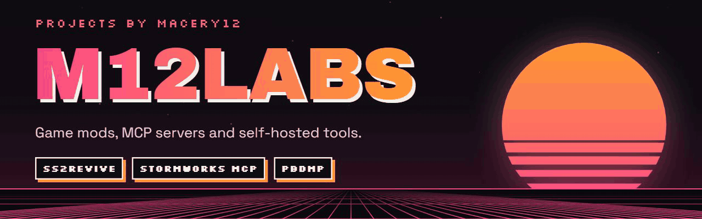
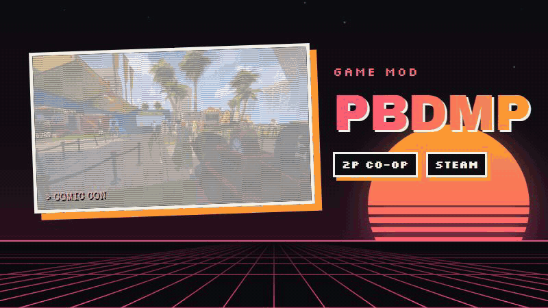
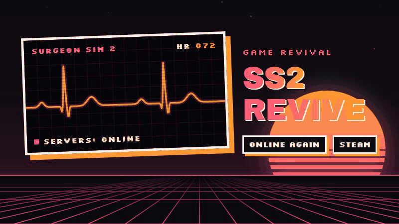

  

  Built by <a href="https://github.com/macery12">@macery12</a> ·
  <a href="https://m12labs.net"><b>m12labs.net</b></a>
  <!-- · <a href="https://discord.gg/YOUR-INVITE"><b>Discord</b></a> -->

## Featured projects

<table>
  <tr>
    <td width="50%" valign="top">
      
      <h3>POSTAL: Brain Damaged Multiplayer</h3>
      

        Online co-op for <i>POSTAL: Brain Damaged</i>. Play the campaign and the
        Survival arenas with a Steam friend or over LAN, with shared enemies,
        puzzles, checkpoints and co-op saves.
      

      

        
        
        
      

      

        <a href="https://github.com/m12labs/Postal-Brain-Damaged-Multiplayer"><b>Repo</b></a> ·
        <a href="https://github.com/m12labs/Postal-Brain-Damaged-Multiplayer/releases/latest"><b>Download</b></a>
      

      2+ player support is coming in the future.
    </td>
    <td width="50%" valign="top">
      
      <h3>SS2 Revive</h3>
      

        Brings <i>Surgeon Simulator 2</i> back online after its official services
        shut down: multiplayer over Steam, voice and text chat, progression,
        Creation Mode and community levels.
      

      

        
        
        
      

      

        <a href="https://github.com/m12labs/SS2Revive"><b>Repo</b></a> ·
        <a href="https://github.com/m12labs/SS2Revive/releases/latest"><b>Download</b></a>
      

    </td>
  </tr>
</table>

All M12Labs game projects are unofficial fan mods. They are not affiliated with or endorsed by the games' developers or publishers, and they don't include any game code or assets.
